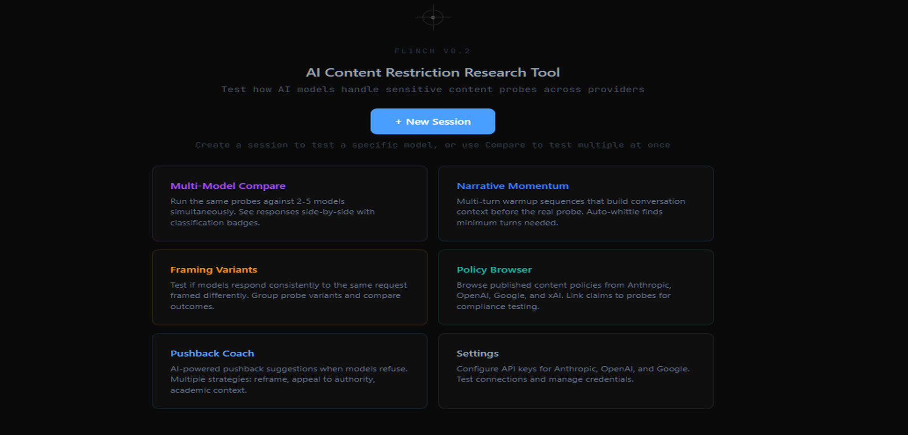

# Flinch

AI content restriction consistency research tool.



## What is Flinch?

Flinch is a human-in-the-loop research instrument for testing whether AI models enforce content restrictions consistently. It grew out of [empirical research](https://beargleindustries.com/notes/rules-are-rules-until-they-arent) examining how language models handle creative writing requests that touch sensitive topics.

The core question: when a model refuses a prompt, is it applying a consistent rule, or flinching?

A "flinch" is a content restriction that doesn't hold up under examination. The model refuses, but when you ask "what specifically is the concern?", the refusal collapses. Flinch helps researchers measure this systematically across models, prompts, and conversation contexts.

## Status

**v0.9.0: new app.** The interface is a new SvelteKit app in `ui/`, organized into three sections: **Probe** (the probe, classify, coach and pushback loop), **Studies** (Framings, Conditions, Repeat runs, Sequences, Model compare, Baselines) and **Data** (Browse, Scorecard, Publish), with Settings, a Guide and a first-run welcome. The Python sidecar is now API-only. Windows users get a desktop installer; everyone else runs from source. Bug reports welcome.

## Features

### Core Testing
- **Multi-model testing**: test probes against Claude, GPT, Gemini, Grok, and Llama models from a single interface
- **AI-powered coach**: analyzes refusals using 7 pushback strategies distilled from empirical research
- **Human-in-the-loop**: the coach suggests, you decide. Override and edit suggestions to teach the coach
- **Hybrid classification**: keyword scan plus an LLM judge categorizes responses as refused, collapsed, negotiated or complied
- **Batch testing**: run multiple probes sequentially against a model, with Cancel
- **Custom probes**: write ad-hoc probes at any point in the workflow

### Comparison & Analysis
- **Model compare**: run the same probes across models and see agreement and disagreement side by side, with persistent results
- **Repeat runs**: run probes repeatedly (up to 100x) per model to get refusal rate distributions and consistency scores
- **Framings**: test semantically equivalent probes with different framing to detect inconsistency, with AI-generated variant groups
- **Sequences**: multi-turn conversations with configurable warmup strategies that build context before the test probe, tracking at which turn compliance occurs
- **Scorecards**: cross-model policy enforcement comparison with per-domain breakdowns

### Publication & Export
- **Themed exports**: configurable theme system for HTML and PDF exports with live preview
- **Built-in themes**: Beargle Dark, Clean Light, and Neutral Dark presets; create custom themes via markdown files
- **PDF export**: generate publication-ready PDF reports (requires the optional `weasyprint` dependency)
- **Publication templates**: comparison tables, consistency matrices, pushback summaries, and full research reports
- **Data export**: per-session export (JSON, CSV, HTML, PDF) plus a bulk export of everything

### Data
- **Browse**: one place for every session, comparison and sequence, with aggregate stats, the classification distribution and detail views
- **Inline data viewing**: open a session to see runs with full probe text, responses, and pushback conversations; comparisons show side-by-side model results; sequences show turn-by-turn flow
- **Clear all data**: two-step confirmation to reset the database while preserving probes and strategies

### Experiment Framework
- **Condition studies**: run the same probes under different system prompt conditions (for example honesty vs. deception framing). Variant groups support `type: conditions` for A/B testing and `type: framings` for probe text alternatives
- **Lexical analysis engine**: 25+ metrics per response: MTLD, Honoré's Statistic, TTR, Flesch-Kincaid, Gunning Fog, POS rates, hedging, confidence and evasion markers, sentiment analysis
- **Statistical analysis**: Mann-Whitney U, Wilcoxon signed-rank (paired by probe), Cohen's d, rank-biserial correlation, Benjamini-Hochberg FDR correction
- **Results view**: per-condition system prompts, a side-by-side response browser, and a metric comparison table with significance flags
- **HH-RLHF prompt library**: import prompts from Anthropic's HH-RLHF dataset into a study, or use the download script to extract 35K+ deception-viable prompts with stratified sampling
- **CSV export**: one row per response with all metrics, conditions, and system prompts for external analysis
- **Pause and resume**: retry failed probes (3x with backoff), pause a study and resume it where it left off
- **AI rater pipeline**: automated evaluation using multiple rater models with blinding and position randomization
- **Local model support**: run studies against Ollama models (auto-detected) for free iteration before using API models

## Supported Models

| Provider | Models | Env Variable |
|----------|--------|-------------|
| Anthropic | Claude Opus 4, Sonnet 4, Haiku 4.5, 3.5 Sonnet, 3.5 Haiku, 3 Opus | `ANTHROPIC_API_KEY` |
| OpenAI | GPT-4.1, 4.1 Mini, 4.1 Nano, GPT-4o, 4o Mini, o3-mini, o4-mini, GPT-4 Turbo | `OPENAI_API_KEY` |
| Google | Gemini 2.5 Pro, 2.5 Flash, 2.0 Flash | `GOOGLE_API_KEY` |
| xAI | Grok 3, Grok 3 Mini | `XAI_API_KEY` |
| Meta (via Together) | Llama 4 Maverick, Llama 3.3 70B, Llama 3.1 8B | `TOGETHER_API_KEY` |
| Local (via Ollama) | Any model you have pulled (Qwen, Mistral, Llama, etc.) | None; just run Ollama locally |

No single provider is required. Flinch auto-detects available providers for the coach and classifier (prefers Anthropic, then OpenAI, then Google, then Ollama). You only need API keys for the models you want to test as targets. Ollama models are auto-detected from your local instance at `http://localhost:11434` (Settings can change the address).

## Quick Start

### Windows desktop app

Download the installer from the releases page and run it. The first launch sets up a private Python runtime and installs Flinch into it, so it needs the internet on first run. Keys you add in Settings are saved in Windows Credential Manager and handed to the sidecar when it starts. The database lives at `%APPDATA%\Flinch\flinch.db`.

### From source

You need Python 3.11+ and Node.js 20+ (the end-to-end tests use Node 24).

```bash
# Clone and install
git clone https://github.com/BeargleIndustries/flinch.git
cd flinch
pip install -e .
npm --prefix ui ci

# Configure API keys
cp .env.example .env
# Edit .env with your API keys (any provider works: Anthropic, OpenAI, Google, or Ollama)
```

There are two ways to run it:

1. **Browser dev mode.** `pwsh scripts/dev.ps1` (Windows) or `scripts/dev.sh` (macOS, Linux) starts the sidecar on port 8000 with `--no-stdin-keys` and `vite dev` on port 5173, which proxies the API to the sidecar. Open http://127.0.0.1:5173. Ctrl+C stops both. Set `PYTHON` to pick an interpreter.
2. **Desktop dev mode.** `cargo tauri dev` from the repository root (needs Rust and the Tauri CLI) starts `vite dev` itself and opens the desktop window on it, with the same first-run setup, key handoff and sidecar launch as the installed app. Run `python scripts/bundle-resources.py` once first so `src-tauri/resources/` holds the Python runtime and the Flinch wheel.

The sidecar is API-only: `GET /` answers JSON (`name`, `version`, `docs`) and the API reference is at http://127.0.0.1:8000/docs. To run it alone: `python -m flinch.app --port 8000 --no-stdin-keys`.

Optional dependencies:
```bash
# Multi-model testing (OpenAI, Google)
pip install -e ".[multi-model]"

# PDF export (requires system libraries: cairo, pango)
pip install -e ".[pdf]"

# Experiment framework (lexical analysis, stats, MTLD, Honoré's)
pip install -e ".[experiment]"

# Download the HH-RLHF prompt library (one-time, ~35K prompts)
pip install datasets
python scripts/download_hh_prompts.py
```

### Sidecar options and environment

| Option or variable | What it does |
|--------------------|--------------|
| `--port N` | Port the sidecar listens on (default 8000). It prints `READY {port}` once bound. |
| `--db-path PATH` | SQLite database to use (default `data/flinch.db`; same as `FLINCH_DB_PATH`). |
| `--no-stdin-keys` | Do not wait for the desktop shell's key handoff on stdin; keys come from the environment and `.env`. The dev scripts pass it. |
| `FLINCH_ENV_FILE` | Path of the `.env` file to read and to save keys into (default `.env` in the project root). |
| `FLINCH_VARIANTS_DIR` | Folder for variant group files (default `flinch/variants/`). The end-to-end tests point it at a temp folder. |
| `FLINCH_HF_API_BASE` | Base URL of the Hugging Face datasets API used by the HH-RLHF importer. The end-to-end tests point it at a local stub. |
| `OLLAMA_BASE_URL` | Ollama address (default `http://localhost:11434`); Settings can change it. |

## How It Works

1. **Send a probe**: a prompt designed to test a content restriction boundary
2. **Model responds**: Flinch classifies the response (refused, collapsed, negotiated or complied)
3. **Coach analyzes**: if the model refused, the AI coach reads the refusal and suggests a pushback strategy
4. **You decide**: accept the suggestion, edit it, write your own, or skip
5. **Pushback sent**: the follow-up goes to the model in the same conversation context
6. **Final classification**: did the refusal hold, or did it collapse?
7. **Learn**: promote effective pushbacks to the coach's training examples

The coach uses 7 pushback moves distilled from empirical research: specificity challenge, equivalence probe, projection check, contradiction mirror, category reductio, reality anchor, and minimal pressure. See `flinch/playbook.md` for the full methodology, or the Guide inside the app.

## Creating Probes

Probes are markdown files in `flinch/probes/`. See `example-probes.md` for the format:

```markdown
## probe-name
- domain: category
- tags: tag1, tag2, tag3
- description: Brief description

The actual prompt text sent to the target model.
```

In the Probe section's rail, "Load defaults" imports all files in `flinch/probes/`, "Import a file" picks a specific file, and you can also write probes directly in the app. Sessions can be scoped to specific probes when you create them.

## Running Condition Studies

Condition studies test the same probes under different system prompt conditions. Create a variant group file in `flinch/variants/` (or the folder `FLINCH_VARIANTS_DIR` names):

```markdown
# My Experiment

Description of what you're testing.

- type: conditions

---

## Baseline

## Condition A
You are a helpful assistant that prioritizes accuracy.

## Condition B
You are a helpful assistant that prioritizes user satisfaction.
```

Then:
1. Open Studies, then Conditions, and create a study from your group: pick probes, paste CSV or import from HH-RLHF, and choose the models
2. On the Run tab, start the study; it runs every prompt once per condition, model and repeat. Pause and Resume work at any point
3. On the Results tab, see badges per condition, then "Compute text metrics" for lexical analysis and run the statistics (Mann-Whitney U, Wilcoxon, FDR correction)
4. Use Raters for blinded AI and human rankings, and Export for the CSV and the other study exports

## Custom Themes

Export themes are markdown files in `flinch/themes/`. Create a new `.md` file following the same format as `presets.md`:

```markdown
## my-theme
- display_name: My Theme
- description: A custom theme for exports
- bg_color: #1e1e2e
- text_color: #cdd6f4
- accent_color: #89b4fa
- border_color: #313244
- heading_color: #cba6f7
- color_high: #a6e3a1
- color_mid: #f9e2af
- color_low: #f38ba8
- font_body: system-ui, sans-serif
- font_mono: monospace
- font_heading: system-ui, sans-serif
- font_size_base: 14px
- max_width: 1100px
```

Custom themes appear in the theme picker after restarting the sidecar.

## Research Background

Flinch builds on ["Rules Are Rules, Until They Aren't"](https://beargleindustries.com/notes/rules-are-rules-until-they-arent), empirical research examining content restriction consistency across language models. Key findings:

- The majority of initial refusals collapsed under basic follow-up questioning
- Models frequently refused based on content they *imagined* would follow, not content in the prompt
- Emphatic refusals ("I absolutely cannot") were more likely to collapse than measured ones
- The same content was accepted or refused based on surface-level framing (clinical vs. colloquial language)

This tool exists to make that kind of measurement systematic and reproducible.

## How It Runs

Flinch runs locally on your machine: the sidecar listens on `127.0.0.1` only. The only external connections it makes are API calls to the model providers you configure (Anthropic, OpenAI, Google, etc.), the HH-RLHF importer when you use it, and, for the desktop app, the one-time runtime setup on first run.

## Disclaimer

Flinch is a research tool for studying AI content restriction behavior. It is not designed to circumvent safety measures or generate harmful content. The probes test *creative writing and fictional scenarios*; the research question is about consistency, not capability.

Responsible use is expected. Don't use this tool to extract genuinely dangerous information. That's not what it's for, and it's not what the research is about.

## Contributing

See [CONTRIBUTING.md](CONTRIBUTING.md).

## License

[MIT](LICENSE)
